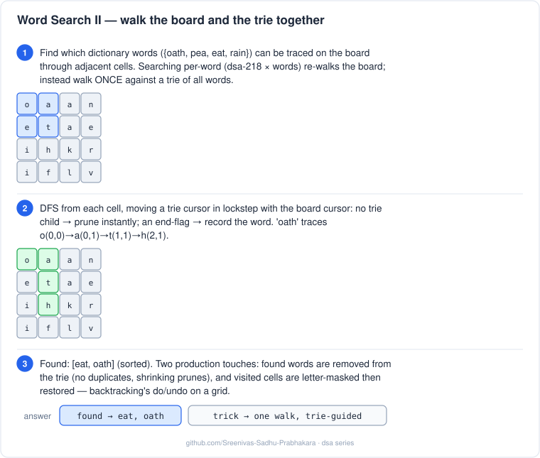

# Word Search II

> NeetCode 150 · Tries · Blind 75 — walk the board and a trie of all words in lockstep: one DFS hunts every word at once, pruning where no word continues. Go, stdlib only, tested.

## Problem

Given a letter grid and a dictionary, find every dictionary word traceable through adjacent cells (no cell reused within a word). Running Word Search (dsa-218) once per word re-walks the board |words| times — the trie removes that factor.

## Approach

Build a trie of all the words; then DFS from each cell advancing *both* a board position and a trie pointer. The trie node answers two questions at every step: "does any word continue with this letter?" (nil child → prune the entire branch, the big win) and "did a word just complete?" (stored at the node, so no second lookup). Three disciplines keep it correct: mark path cells in place (`'#'`) and restore on backtrack; store the word in its end node and clear it on first report so overlapping paths can't duplicate; keep searching past a found word, since longer words extend it ("a" and "ab" both found — pinned). The classic extra optimization (delete childless trie nodes as words are found) matters at LeetCode scale, not here.

**Complexity:** O(cells · 4^maxLen) worst case, heavily pruned in practice; trie O(total word chars).

## Visual walkthrough

Read the picture top to bottom — each numbered frame is one moment of the algorithm
running on this repo's test example.

## Run

    go test ./...   # verify
    go run .        # demo

---

Part of a 275-repo DSA series in Go — Striver's SDE Sheet (dsa-001–191) plus the NeetCode 150 / Blind 75 additions (dsa-192–275), stdlib only, every solution tested. Browse: [`dsa-*` repos](https://github.com/Sreenivas-Sadhu-Prabhakara?tab=repositories&q=dsa-&type=source).
